# NovaInsert

**A REAPER-only VST3 hardware insert for macOS (Apple silicon), Windows (x64) and Linux (x86_64) that measures its own latency.**
Version 1.3.0 · by [Hillside Studios](https://hillsidestudio.io) · free to use, provided as is without any warranty (see [License](#license)).

**[Download NovaInsert 1.3.0](https://github.com/aftec1570/novainsert/releases/latest)**: macOS (signed and notarized DMG) ·
Windows x64 (zip) · Linux x86_64 (tar.gz, beta) ·
[User manual](docs/manual/NovaInsert-User-Manual.md) ([PDF](docs/manual/NovaInsert-User-Manual.pdf))

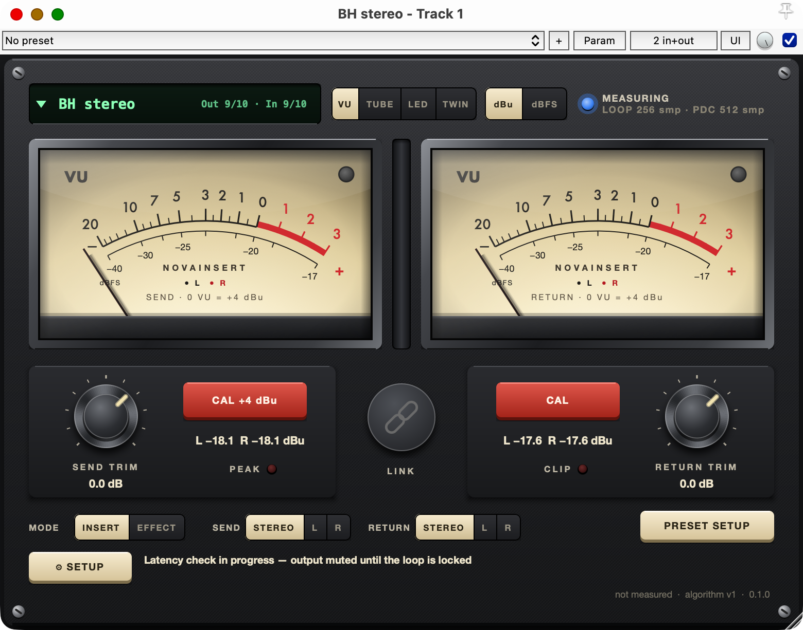

NovaInsert puts a piece of outboard gear into a REAPER track like any other plug-in. It sends the track to a physical
output of your audio interface, takes the return from a physical input, measures the exact round-trip delay through the
converters, cables and the device itself, and tells REAPER that delay so the return lines up to the sample. It also keeps
the analog levels where the outboard expects them, with VU meters, level bars, trims and a one-press level calibration.

The full user manual ships in the DMG as a PDF (Windows and Linux: [docs/manual](docs/manual/NovaInsert-User-Manual.pdf) in this
repository). This page is the short version.

## What it does

- **Measures latency itself.** No ping button. When you pick a device, NovaInsert sends a single click through the loop
  (like REAPER's ReaInsert ping), repeats it three times, and only accepts the delay when all three clicks come back at
  the same sample. It takes about a third of a second. The result shows as **Locked** with the loop length in samples.
- **Keeps the result right.** If the buffer size, the audio device, the routing or the mode changes, the plug-in
  re-measures or re-applies a stored calibration on its own and tells you why. A wrong value is never used silently.
  Opening a project measures every loop again, so a patch change made while the project was closed is caught.
- **Compensates exactly.** The delay reported to REAPER is the measured loop plus a two-block margin, rounded up to whole
  blocks. REAPER's plug-in delay compensation does the rest.
- **Renders without surprises.** Renders, freeze and render-to-stem-tracks run in realtime automatically, and your
  setting is restored afterwards. A render is refused, with a message naming the track, if any insert is not ready.
- **Handles many devices.** No limit on instances in one project (validated with twenty). Each physical channel has one owner; a second instance
  on the same channels waits instead of corrupting the first one.
- **Gets the levels right.** A SEND meter referenced to +4 dBu, a RETURN meter referenced to your converter's alignment,
  trims from −24 to +12 dB, LINK, and a level calibration that puts the send at the outboard's working point and brings the
  return back to digital unity.
- **Explicit mono and stereo.** Each preset says whether its send and its return are mono or stereo. A mono send carries
  the track's mix on one output; a mono return comes back on both sides. A stereo unit can also be used one side at a time.
- **A device library.** Every unit is a named preset. Pick "Pultec" and the FX slot in the mixer reads "Pultec".

## Safety notice

NovaInsert sends signals to real outputs and reads real inputs. A wrong channel number, a cable into a monitor path or an
accidental feedback loop can produce loud, sustained sound.

- Start with the monitor level low the first time you select a device.
- Never choose output channels that feed your monitors, headphones or a cue mix.
- Never calibrate into a monitoring path: the RETURN CAL tone is a steady sine at 0 VU.
- Check the preset's channel numbers against the interface's own routing before use.

You are responsible for the routing, the monitoring level and the hardware. See the license agreement for the full terms.

## Requirements

| Requirement | Value |
|---|---|
| Host | REAPER 7.83 or newer (validated on 7.83 and 7.85) |
| Platform | macOS on Apple silicon (arm64); Windows 10 or 11 x64; Linux x86_64 with glibc 2.35 or newer (Ubuntu 22.04 or newer), beta |
| Plug-in format | VST3 only |
| Sample rate | 44.1, 48, 88.2, 96 or 192 kHz (macOS: hardware-validated on the Apollo at all five; change the rate only while stopped) |
| Audio device | macOS: one specific CoreAudio device selected in REAPER, not the system default; Windows: the interface's native ASIO driver; Linux: one specific ALSA device (`hw:` or `plughw:`), not `default` |
| Instances | no limit (20 active instances validated; more are up to your CPU at small buffers) |
| Loop length | up to 65 536 samples |

**Audio driver.** NovaInsert works only on REAPER's native driver for the platform: CoreAudio on macOS, ASIO on Windows,
ALSA on Linux. On any other driver (JACK, PulseAudio, Dummy Audio, …) it does not arm or measure and shows
"REAPER's audio driver is not supported. NovaInsert needs ASIO on Windows / ALSA on Linux". Switch REAPER to the native
driver in Options → Preferences → Audio → Device.
On Windows the ASIO driver must be the interface's own: ASIO4ALL and FlexASIO count as unsupported too. On an unsupported
Windows driver (WASAPI, WaveOut, DirectSound, ASIO4ALL, FlexASIO, …) NovaInsert bypasses itself (the track plays dry) and
shows "Audio driver not supported, NovaInsert is bypassed. Use the interface's own ASIO driver (not ASIO4ALL or FlexASIO)".

**Validation.** macOS is validated on real hardware (a UA Apollo with analog outboard loops). Windows is validated on real hardware with an RME Babyface Pro on its native ASIO driver and analog cable loops (latency measurement at buffer sizes 64 to 512, delay compensation changes, online render, fault handling); other ASIO interfaces and outboard have not been tested yet, and reports are welcome. Linux is functionally
validated in a virtual environment; hardware timing validation pending (beta). Reports from real ALSA interfaces are welcome.

## Install

### macOS

1. Download `NovaInsert-1.3.0-macOS-arm64.dmg` from the [release page](https://github.com/aftec1570/novainsert/releases/latest).
2. Open the DMG and double-click "Install NovaInsert 1.3.0.pkg".
3. Read and accept the license agreement; the installer copies the plug-in to `/Library/Audio/Plug-Ins/VST3`.
   The package is signed with an Apple Developer ID and notarized by Apple, so macOS opens it without a security prompt.
4. In REAPER: Options → Preferences → Plug-ins → VST → "Re-scan". Add "VST3: NovaInsert (Hillside Studios)" to a track.

### Windows

1. Download `NovaInsert-1.3.0-Windows-x64.zip` and its `.sha256` from the
   [release page](https://github.com/aftec1570/novainsert/releases/latest); check it in PowerShell with
   `Get-FileHash NovaInsert-1.3.0-Windows-x64.zip` against the value in the `.sha256` file.
2. Unpack the zip and copy the folder `NovaInsert.vst3` to `C:\Program Files\Common Files\VST3\` (needs administrator rights).
   The zip is not code-signed, so Windows or your browser may warn about an unknown publisher.
3. In REAPER: select the ASIO driver of your interface (Options → Preferences → Audio → Device), then
   Options → Preferences → Plug-ins → VST → "Re-scan".

### Linux (beta)

1. Download `NovaInsert-1.3.0-Linux-x86_64.tar.gz` and its `.sha256` from the
   [release page](https://github.com/aftec1570/novainsert/releases/latest); check it with `sha256sum -c *.sha256`.
2. `tar xzf NovaInsert-1.3.0-Linux-x86_64.tar.gz && ./install.sh` copies the plug-in to `~/.vst3` (no sudo). For all
   users, copy `NovaInsert.vst3` to `/usr/lib/vst3/` instead.
3. In REAPER: select the ALSA driver and a specific device, then Options → Preferences → Plug-ins → VST → "Re-scan".

## First use: define your devices

A device is a preset: a name, a mono or stereo send with its output channel(s), a mono or stereo return with its input
channel(s), the mode and the level settings. Presets are created and edited on the PRESET SETUP page of the editor; the
name you give a preset is what the device list and the FX slot in REAPER's mixer show.

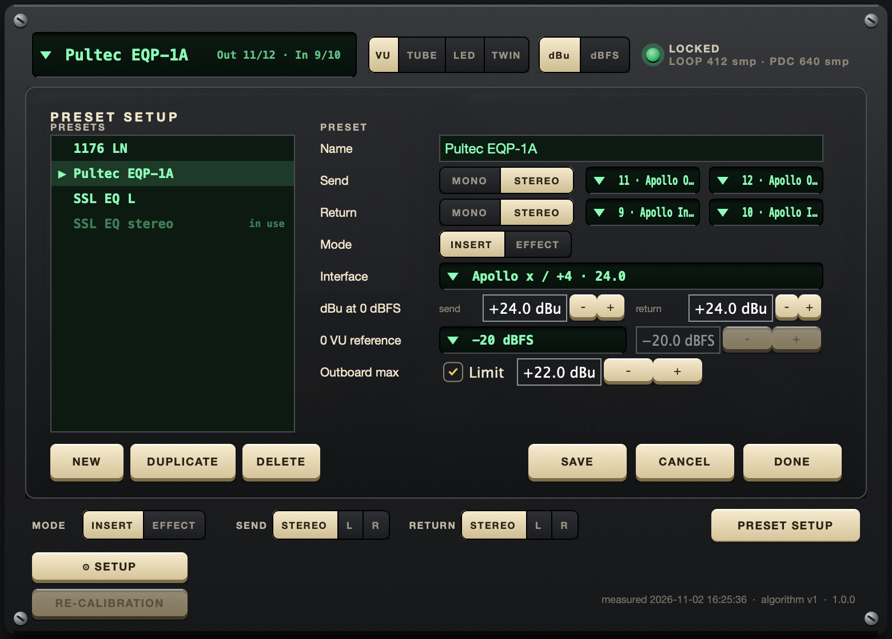

Open the editor, press PRESET SETUP, then NEW:

1. **Name** – the preset name; it appears in the FX slot the moment the preset is saved.
2. **Send** – MONO or STEREO, then the physical output channel(s), picked by the name REAPER reports ("3 · Out 3").
   A mono send carries the average of the track's two channels on its one output.
3. **Return** – MONO or STEREO, then the physical input channel(s). A mono return feeds both channels of the track.
4. **Mode** – INSERT for compressors, equalisers and other gear that keeps timing; EFFECT for reverbs and delays.
5. **Interface / dBu at 0 dBFS / 0 VU reference / Outboard max** – the level settings, stored with the preset.
6. **SAVE** – writes the preset, selects it in this instance and starts the measurement at once. Nothing about latency is
   stored with a preset: every selection measures the loop again, so a preset is always checked against the hardware as
   it is now.

DUPLICATE is the quickest way to store the two channels of a stereo unit as "SSL EQ 1", "SSL EQ 2" and "SSL EQ stereo".
DELETE is refused while another track uses the preset. The presets live in
`~/Library/Application Support/REAPER/NovaInsert/devices.json` and can also be edited by hand with REAPER closed.

## The editor

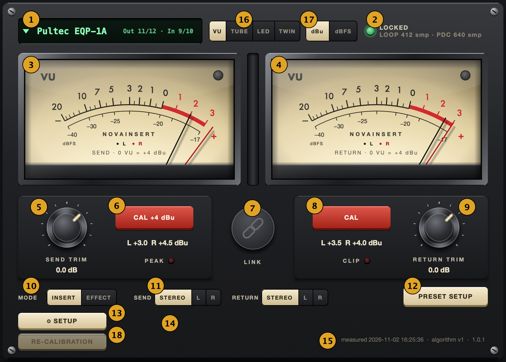

| № | Area | What it does |
|---|---|---|
| 1 | Device selector | names the selected device and the physical channels it owns; click to pick another preset or "No device" |
| 2 | Status lamp | the measurement state in colour and text, with the measured LOOP and the PDC reported to REAPER |
| 3 | SEND meter | VU of the signal leaving for the outboard; 0 VU = +4 dBu at the converter output |
| 4 | RETURN meter | VU of the signal coming back; 0 VU = the dBFS reference set in SETUP |
| 5 | SEND TRIM | gain before the converter, −24 to +12 dB; double-click resets to 0 |
| 6 | CAL +4 dBu | sets the send trim so the track itself leaves at 0 VU = +4 dBu |
| 7 | LINK | couples the two trims: more send, less return, same mix level |
| 8 | CAL (return) | measures the return and sets the return trim to digital unity |
| 9 | RETURN TRIM | gain after the converter input, −24 to +12 dB |
| 10 | MODE | INSERT (measured loop) or EFFECT (driver latency, tails preserved) |
| 11 | SEND and RETURN | shown for a stereo send / return only: STEREO uses both channels, L or R uses that one side of the unit |
| 12 | PRESET SETUP | the preset editor: create, edit, duplicate and delete devices |
| 13 | SETUP | converter alignment, 0 VU reference, channel offsets, skin, editor size, measure on project open |
| 14 | Status lines | calibration messages, the failure reason, warnings and tips |
| 15 | Footer | time of the last measurement, the algorithm version and the plug-in version |
| 16 | VU / TUBE / LED / TWIN | switches the meter area between the two VU faces and three level-bar looks |
| 17 | dBu / dBFS | the unit of both meters' readouts |
| 18 | RE-CALIBRATION | measures the loop again; available only after a failed calibration |

Rest the mouse pointer on any control for a moment and a short tip says what it does. The window resizes from its lower
right corner between 50 % and 300 %; everything is vector-drawn, so it stays sharp at any size and on Retina displays.

### States and the status lamp

| Colour | State | Meaning |
|---|---|---|
| grey | Idle | no device selected |
| blue | Queued | waiting for other instances to finish measuring (the position is shown) |
| blue | Measuring | the clicks are running (well under a second); the track output is muted meanwhile |
| blue | Applying latency | measured; waiting for REAPER to pick up the new delay on the next play |
| green | Locked | aligned; LOOP is the measured round trip, PDC the delay reported to REAPER |
| amber | Stale | something changed since the measurement; a re-measure is pending |
| red | Failed | the measurement did not lock; the reason is on the status line |
| red | Unavailable | the channels are owned by another instance, or the audio device is gone |
| red | Unsupported host | a REAPER setting NovaInsert needs is off (anticipative FX) or the REAPER version lacks an API |
| red | Unsupported sample rate | the device runs at a rate other than 44.1, 48, 88.2, 96 or 192 kHz |

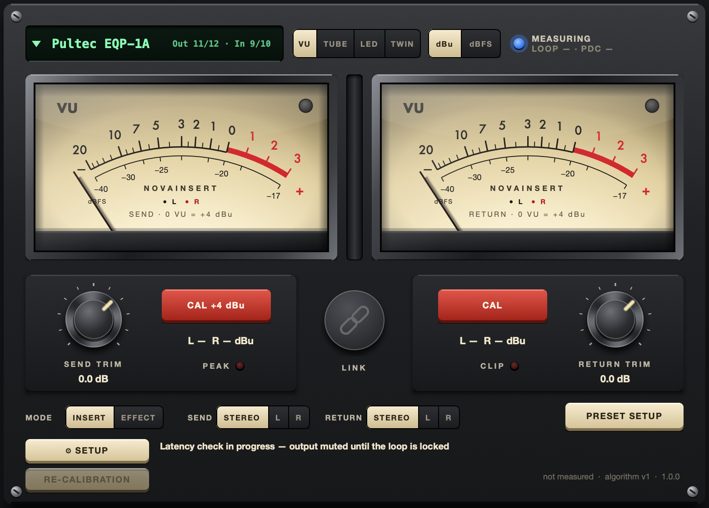

A failed measurement names its cause: no signal came back (cable or channel number), the return clipped, the loop had two
candidate delays (an echo or crosstalk from a neighbouring unit), or the return was too weak. Fix the cause and press
**RE-CALIBRATION** to measure again. The button is available only after a failed calibration, including a failed check on
project open, where the latency saved with the project keeps running until a new measurement locks.

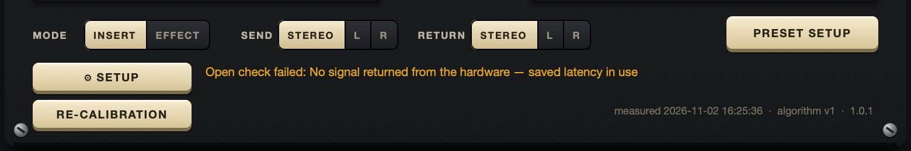

### Meters, trims and LINK

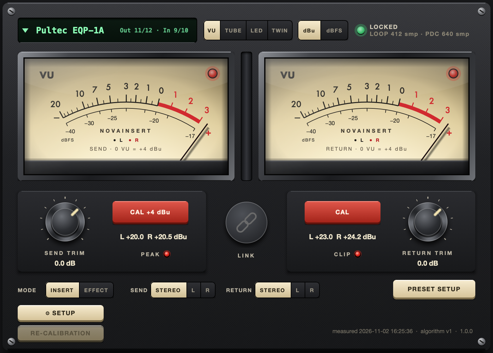

The two VU meters move like real ones (IEC 60268-17 ballistics): a mono device shows one needle, a stereo device two,
black for L and red for R, with a dBFS sub-scale under the VU scale. PEAK lights when the send reaches −0.1 dBFS, CLIP
when a returned sample is above 0 dBFS (the converter input overloaded).

The rocker in the top bar switches to level bars in three looks: **TUBE** (backlit cream face, glass tubes), **LED**
(smoked glass, 60 LEDs per channel, one per dB) and **TWIN** (two windows the size of the VU faces). All three show peak,
RMS and a 10-second peak hold on a dBu scale above and a dBFS scale below, with the 0 VU reference line.

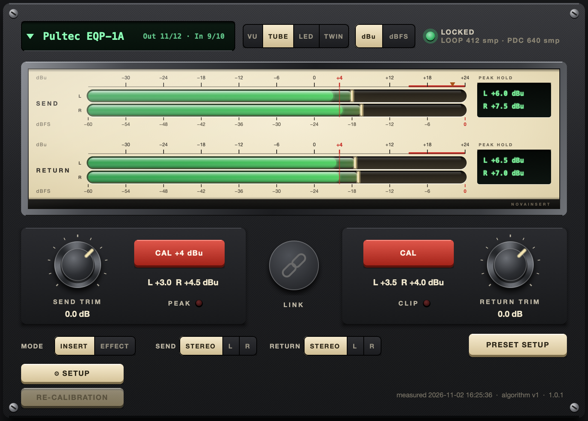

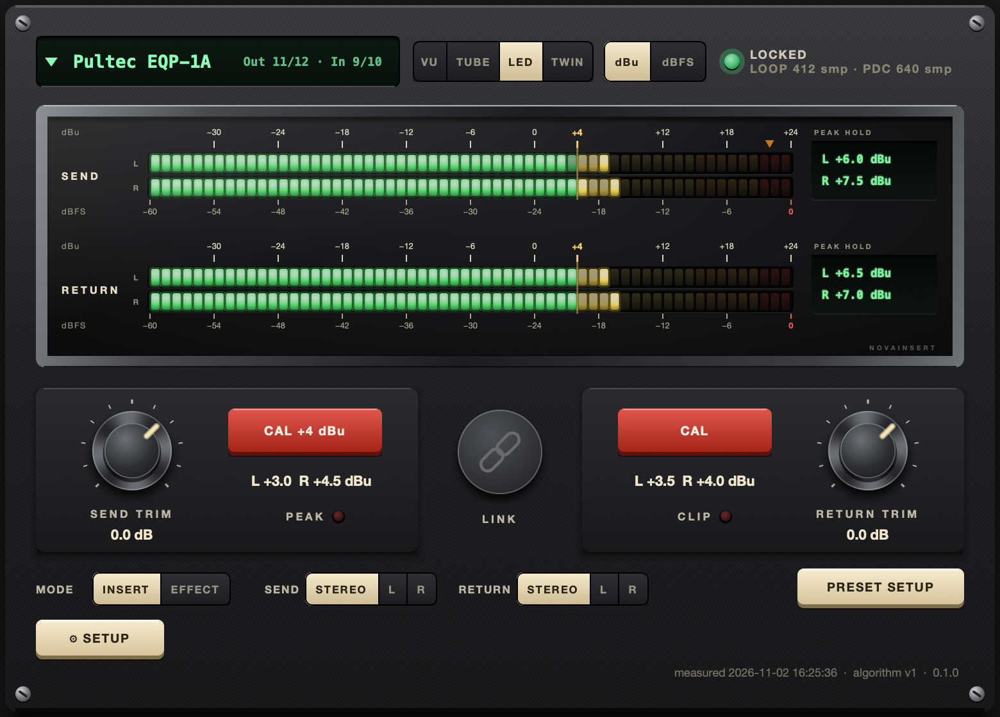

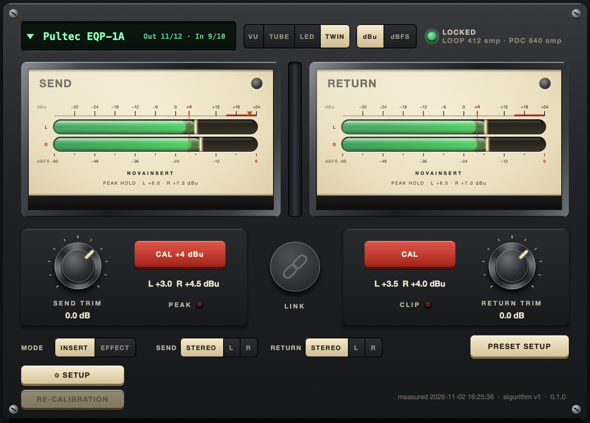

SEND TRIM sits before the converter output, RETURN TRIM after the converter input, each −24 to +12 dB; both are REAPER
parameters and can be automated. With LINK on, raising the send by 3 dB lowers the return by 3 dB, so you can drive the
outboard harder without changing the level of the mix.

### Level calibration

Most outboard expects line level around +4 dBu. A converter aligned to +24 dBu at 0 dBFS sends a full-scale DAW signal
20 dB above that. The calibration solves this per device, once:

1. **SETUP:** the Interface line shows the audio device REAPER runs; enter its dBu-at-0-dBFS values from the
   interface's manual (separately for send and return, default +24.0) and the 0 VU reference you work with.
2. Put the outboard in a neutral state: unity gain, EQ flat, compression off.
3. **CAL +4 dBu (SEND CAL):** play the track and press the button. NovaInsert listens to 3 seconds of the track's own
   material (no tone, nothing muted) and sets SEND TRIM so its average leaves the converter at 0 VU = +4 dBu.
4. **CAL (RETURN CAL):** a tone goes through the neutral outboard; NovaInsert measures what comes back and sets the return
   trim so the plug-in's output equals its input. Stereo units are calibrated per channel. If the return clips at the
   converter, nothing is written and you are asked to lower the outboard's output.

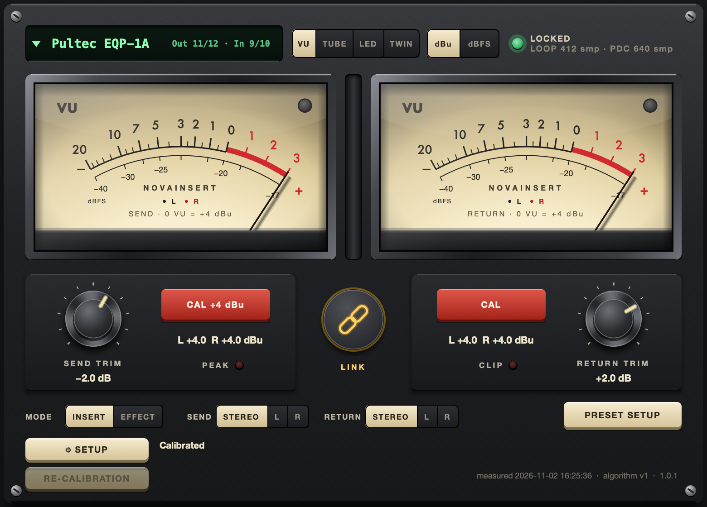

The RETURN CAL result is stored in the instance and as the default of the device preset.

### Skins

SETUP offers three colour schemes for the whole editor: DARK (default), IVORY and SILVER. They change colours only.

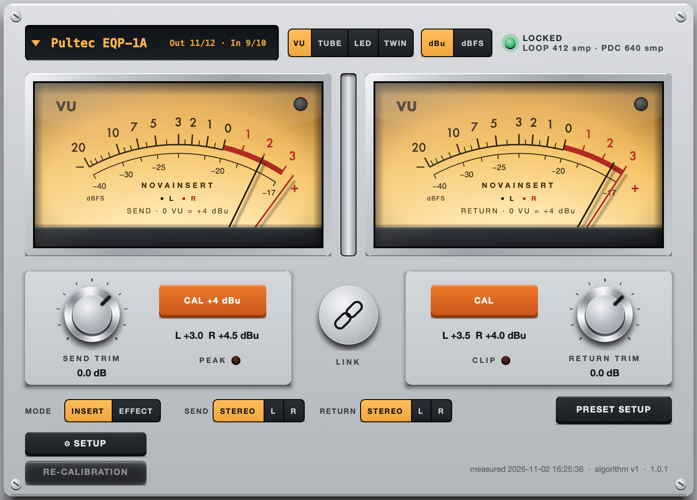

## Insert and Effect mode

**INSERT** is for gear whose return is the processed version of the send: equalisers, compressors, summing, tape. The loop
is measured and the return is placed exactly.

**EFFECT** is for gear with a tail: reverbs, delays. Nothing is ever measured; NovaInsert reports the audio driver's own
round trip plus the two-block margin, re-reads it on every buffer change, and leaves the return alone. Alignment in Effect
mode is as exact as the driver's figure, not sample-measured.

## Mono and stereo routing

- **Stereo send** – L to the first output, R to the second. No summing, no swapping.
- **Mono send** – (L + R) / 2 to the one output; a mono track leaves at exactly its own level.
- **Stereo return** – the first input to L, the second to R.
- **Mono return** – the one input to both channels of the track.

For a stereo send or return the main panel shows a SEND or RETURN selector: STEREO uses both channels of the unit, L or R
uses only that side as a mono loop. The selectors are part of the calibration key, so changing them re-measures.

## Rendering

Hardware cannot run faster than real time, so a render through NovaInsert is a realtime render, and you do not have to
remember this:

- Starting a render (master mix, stems, selected tracks, regions, the region matrix, a dry run) sets REAPER's render speed
  to realtime and restores your setting afterwards.
- Freeze and render tracks to stem tracks (stereo, mono, multichannel) also run in realtime: NovaInsert switches REAPER's
  "Limit apply FX/render stems to realtime" on for the action and puts your setting back afterwards.
- Before any of these starts every active instance is checked; if one is not Locked it is refused and a message names the
  tracks. No file is written.
- **Apply FX to items** is refused while an instance is active: REAPER stops the audio interface during Apply FX, so the
  outboard cannot be part of the result. Use Freeze or Render tracks to stem tracks instead.
- The render queue renders a saved copy of the project and cannot go through hardware; it is refused while an instance is
  active.

REAPER fills the compensation delay from the start of each play or render pass, so the first "loop length" samples of a
pass have no hardware return yet. NovaInsert reports the gap instead of hiding it; enable REAPER's pre-roll and set the
"Pre-roll lead-in" parameter to clear the tip.

## Several devices, anticipative FX, files

- Each physical channel has one owner. A second instance sharing a channel shows "Device in use by <track>", stays muted
  and takes over when the owner releases the channels. Measurements of different units run in parallel; a click disturbed
  by a neighbour's click is repeated alone.
- REAPER's "anticipative FX processing" breaks a live hardware loop. NovaInsert turns it off for every track that holds an
  instance (and the folders above it) and restores it when the last instance leaves. The global preference is never touched.
- `…/REAPER/NovaInsert/devices.json` holds the presets, `…/REAPER/NovaInsert/calibrations.json` the measured loops (one
  per interface, channels, buffer size, routing and mode) and `…/REAPER/NovaInsert/settings.json` the global settings. The
  REAPER project stores a snapshot of the instance's preset and calibration, so a later edit of the library cannot change
  how an old project sounds.

## Parameters

| Parameter | Values | Notes |
|---|---|---|
| Device | 0 = none, 1… = library index | the same as the device selector |
| Mode | Insert, Effect | |
| Send | Stereo, L, R | the side of a stereo send; a mono send ignores it |
| Return | Stereo, L, R | the side of a stereo return; a mono return ignores it |
| Stereo | off/on | follows the preset |
| Send trim, Return trim | −24 … +12 dB | |
| Link | off/on | |
| Pre-roll lead-in | off/on | hides the start-gap tip |
| Re-apply anticipative FX fix | trigger | the same as the button |
| State, Physical loop, Reported PDC, Inherent gap, CAL action, CAL status | read only | for scripts and controllers |

## Limitations of version 1.3.0

- 44.1, 48, 88.2, 96 or 192 kHz (hardware-validated on the Apollo at all five; change the rate only with the transport stopped, every loop then re-measures on its own), REAPER 7.83 or newer (validated on 7.83 and 7.85), VST3 only.
- macOS Apple silicon, Windows x64 and Linux x86_64 only. CoreAudio (macOS), ASIO (Windows) and ALSA (Linux) only.
- Windows is validated on one interface (RME Babyface Pro) with cable loops; other ASIO interfaces are untested. The zip is not code-signed.
- Linux is functionally validated in a virtual environment; hardware timing validation pending (beta).
- Presets are stored by position: deleting one shifts the later ones in projects not reopened since.
- The first "loop length" samples of each play or render pass have no hardware return.
- Effect mode alignment is driver-reported, not sample-measured.
- Apply FX to items and the render queue are refused while an instance is active (freeze and stem tracks render in realtime).
- A change of the outboard's own settings after the calibration is not detected.
- Analog overload inside the outboard is not detectable.

## Build from source

Requirements: CMake 3.25 or newer and a C++20 compiler; macOS on Apple silicon (Xcode command line tools), Windows x64
(Visual Studio 2022, MSVC) or Linux x86_64 (GCC 11 or newer). JUCE 8 (which carries the VST3 SDK), the REAPER SDK and Catch2 are git submodules. Linux build
dependencies (Ubuntu 22.04 package names): `build-essential cmake ninja-build libasound2-dev libx11-dev libxrandr-dev
libxinerama-dev libxcursor-dev libxext-dev libfreetype6-dev libfontconfig1-dev libgl1-mesa-dev`.

```bash
git clone --recursive https://github.com/aftec1570/novainsert.git
cd novainsert
cmake -B build-release -DCMAKE_BUILD_TYPE=Release          # Linux: add -G Ninja
cmake --build build-release --target NovaInsert_VST3
# the plug-in: build-release/src/NovaInsert_artefacts/Release/VST3/NovaInsert.vst3
cmake --build build-release            # also builds the unit tests and the manual screenshot tool
build-release/tests/novainsert_unit_tests
```

The unit tests (`tests/unit`, Catch2) and the manual screenshot tool are part of the build. `tools/package_archive.sh
build-release dist` packs a Windows or Linux build into the release zip or tar.gz (read-me, license, sha256; `install.sh` on Linux). The hardware bench harness that
validated the plug-in on a real audio interface (REAPER scripts and captures) is not part of this repository.

### Installer and release

`tools/make_installer.sh` builds `dist/NovaInsert-<version>-macOS-arm64.dmg` from the Release VST3: a standard macOS installer
(welcome → license agreement that must be accepted → install to `/Library/Audio/Plug-Ins/VST3`) plus `LICENSE.md`, the
manual PDF and a read-me. Without the identities below the build is unsigned (macOS then needs System Settings → Privacy & Security → "Open
Anyway"). Signed, notarized release build (the published DMG is built this way):

1. Xcode → Settings → Accounts → Manage Certificates: create "Developer ID Application" and "Developer ID Installer".
2. `xcrun notarytool store-credentials novainsert --apple-id <Apple Account> --team-id <TEAMID>` (app-specific password).
3. `NI_SIGN_IDENTITY="Developer ID Application: <Name> (<TEAMID>)" NI_INSTALLER_IDENTITY="Developer ID Installer: <Name> (<TEAMID>)"
   NI_NOTARY_PROFILE=novainsert tools/make_installer.sh` – signs the VST3 (hardened runtime, timestamp) and the pkg,
   notarizes and staples the pkg and the DMG, and ends with `spctl --assess` on the pkg ("accepted, source=Notarized Developer ID").

### User manual

`docs/manual/NovaInsert-User-Manual.md` (+ the committed PDF, shipped in the DMG as "NovaInsert User Manual.pdf").
Screenshots come from `tests/tools/manual_shots.cpp` (`ni_manual_shots docs/manual/img`, fixed view states at 2×, no
hardware needed); the PDF is rebuilt with `python3 -I tools/manual_build.py docs/manual/NovaInsert-User-Manual.md
docs/manual/NovaInsert-User-Manual.html docs/manual/NovaInsert-User-Manual.pdf` (headless Google Chrome, no other deps).

## About Hillside Studios

NovaInsert is made by Hillside Studios. If you are interested in the studio and its work, visit
[hillsidestudio.io](https://hillsidestudio.io).

## License

Free to use, including in professional and commercial audio work. Provided **as is, without any
warranty**; Hillside Studios accepts no liability for damage to equipment, hearing or data. Commercial reuse of the source code
or the GUI design requires prior consultation with Hillside Studios. Full terms: `LICENSE.md`. Built with JUCE 8 (JUCE 8 EULA)
and the VST3 SDK (MIT). VST is a trademark of Steinberg Media Technologies GmbH. REAPER is a trademark of Cockos
Incorporated.
