# NovaInsert User Manual

Version 1.0.0 · November 2026 · REAPER-only VST3 hardware insert for macOS (Apple silicon) · by Hillside Studios, [hillsidestudio.io](https://hillsidestudio.io)

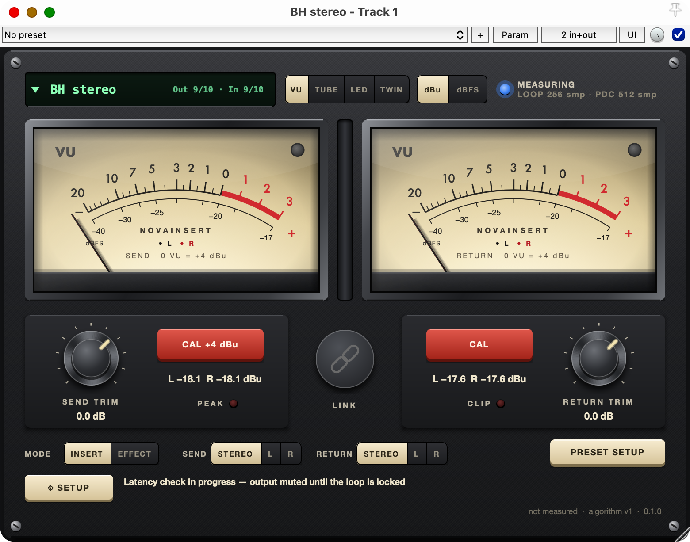

NovaInsert puts a piece of outboard gear into a REAPER track like any other plug-in. It sends the track to a physical output of your audio interface, takes the return from a physical input, measures the exact round-trip delay through the converters, cables and the device itself, and tells REAPER that delay so the return lines up to the sample. It also keeps the analog levels where the outboard expects them, with VU meters, trims and a one-press level calibration.

This manual covers version 1.0.0. The plug-in is free to use and comes as is, without any warranty. Read the safety notice in chapter 2 before you connect anything.

## 1. What NovaInsert does

- **Measures latency itself.** No ping button. When you pick a device, NovaInsert sends a single click through the loop (like REAPER's ReaInsert ping), repeats it three times, and only accepts the delay when all three clicks come back at the same sample. It takes about a third of a second. The result appears as "Locked" with the loop length in samples.
- **Keeps the result right.** If the buffer size, the audio device, the routing or the mode changes, the plug-in re-measures or re-applies a stored calibration on its own and tells you why. A wrong value is never used silently.
- **Compensates exactly.** The delay reported to REAPER is the measured loop plus a two-block margin, rounded up to whole blocks. REAPER's plug-in delay compensation does the rest.
- **Renders without surprises.** Starting a render switches REAPER to realtime rendering automatically and restores your setting afterwards. A render is refused, with a message naming the track, if any insert is not ready.
- **Handles many devices.** Up to twenty instances in one project. Each physical channel has one owner; a second instance on the same channels waits instead of corrupting the first one.
- **Gets the levels right.** A SEND meter referenced to +4 dBu, a RETURN meter referenced to your converter's alignment, trims from −24 to +12 dB, LINK, and a level calibration that puts the send at the outboard's working point and brings the return back to digital unity.
- **Explicit mono and stereo.** Each preset says whether its send and its return are mono or stereo. A mono send carries the track's mix on one output; a mono return comes back on both sides. A stereo unit can also be used one side at a time. Nothing passes through unseen.
- **A device library.** Every unit is a named record. Pick "Pultec" and the FX slot in the mixer reads "Pultec".

## 2. Safety notice

NovaInsert sends signals to real outputs and reads real inputs. A wrong channel number, a cable into a monitor path or an accidental feedback loop can produce loud, sustained sound.

- Start with the monitor level low the first time you select a device.
- Never choose output channels that feed your monitors, headphones or a cue mix.
- Never calibrate into a monitoring path: the RETURN CAL tone is a steady sine at 0 VU.
- Check the device record's channel numbers against the interface's own routing before use.

You are responsible for the routing, the monitoring level and the hardware. See the license agreement for the full terms.

## 3. Requirements and installation

| Requirement | Value |
|---|---|
| Host | REAPER 7.83 or newer (validated on 7.83 and 7.85), macOS, Apple silicon (arm64) |
| Plug-in format | VST3 only |
| Sample rate | 48 kHz |
| Audio device | one specific CoreAudio device selected in REAPER, not the system default |
| Instances | up to 20 active instances validated |
| Loop length | up to 65 536 samples |

**Install from the DMG**

1. Open the DMG and double-click "Install NovaInsert 1.0.0.pkg".
2. Read and accept the license agreement, then let the installer copy the plug-in to `/Library/Audio/Plug-Ins/VST3`.
3. The package is signed with an Apple Developer ID and notarized by Apple, so macOS opens it directly without a security prompt.
4. In REAPER open Options, Preferences, Plug-ins, VST and press "Re-scan". Add "VST3: NovaInsert" to a track.

## 4. Before the first use: define your devices

A device is a preset: a name, a mono or stereo send with its output channel(s), a mono or stereo return with its input channel(s), the mode and the level settings. Presets are created and edited on the PRESET SETUP page of the editor; the name you give a preset is what the device list and the FX slot in REAPER's mixer show.

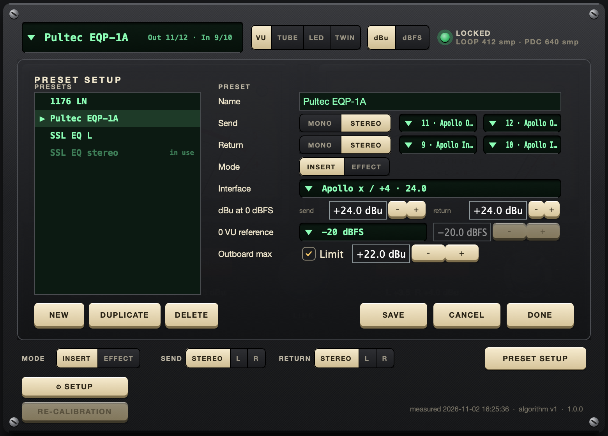

Open the editor (any instance), press PRESET SETUP and then NEW:

1. **Name** — type the preset name. It appears in the FX slot the moment the preset is saved.
2. **Send** — MONO or STEREO, then the physical output channel(s) of the audio interface, picked by the name REAPER reports for them ("3 · Apollo Out 3"). A mono send shows one picker; the signal that leaves on it is the average of the track's two channels, so a mono unit never needs two outputs.
3. **Return** — MONO or STEREO, then the physical input channel(s) the return arrives on. A mono return shows one picker; what comes back on it feeds both channels of the track.
4. Send and return are independent: a mono-in, stereo-out unit is a mono send with a stereo return.
5. **Mode** — INSERT for compressors, equalisers and other gear that keeps timing; EFFECT for reverbs and delays (chapter 11).
6. **Interface / dBu at 0 dBFS / 0 VU reference / Outboard max** — the level settings of chapter 10, stored with the preset.
7. **SAVE** — writes the preset, selects it in this instance and starts the measurement at once. Nothing about latency is stored with a preset: every selection measures the loop again (chapter 7), so a preset is always checked against the hardware as it is now.

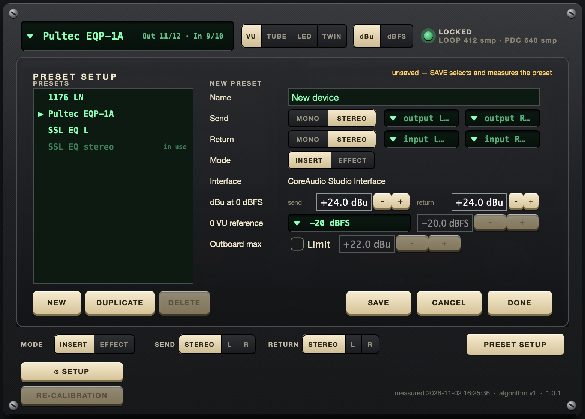

DUPLICATE copies the selected preset under a new name, which is the quickest way to store the two channels of a stereo unit as "SSL EQ 1" (mono send and return, out 11, in 9), "SSL EQ 2" (mono, out 12, in 10) and "SSL EQ stereo" (both). A stereo preset can also be used one side at a time with the SEND and RETURN selectors of the main panel (chapter 12), without a second preset. Each preset has its own calibration and its own level defaults. DELETE removes a preset; it is refused while another track uses it ("In use by <track>"). CANCEL drops unsaved edits, DONE closes the page.

The presets live in a small JSON file in REAPER's resource path and can still be edited by hand with REAPER closed; the editor picks up the change within a second:

```
~/Library/Application Support/REAPER/NovaInsert/devices.json
```

| Field | Meaning |
|---|---|
| `id` | a short unique name derived from the preset name when it is created; projects refer to the record by it |
| `name` | what the device list and the FX slot show |
| `sendStereo`, `returnStereo` | `true` for a two-channel send / return, `false` for one channel (files from before 0.1.0 with a single `stereo` key still load; it sets both) |
| `out` | physical output channel(s) of the audio interface, counted from 0: `[10]` is REAPER's "Out 11", `[10, 11]` is "Out 11/12" |
| `in` | physical input channel(s), counted from 0 |
| `mode` | `0` Insert, `1` Effect |
| `vuRefDbfs` | the 0 VU reference of the RETURN meter, default −20 |
| `sendDbuAt0dBFS`, `returnDbuAt0dBFS` | converter alignment in dBu, default 24 (Apollo at the +4 reference) |
| `outboardMaxInDbu` | optional, the unit's maximum input level, shown as a marker on the SEND scale |
| `sendTrimDb`, `returnTrimDb`, `link`, `sendOffsetDb`, `returnOffsetDb` | the device defaults the level calibration writes (chapter 9) |

NovaInsert writes the file atomically and never overwrites a file it cannot read: a corrupt library shows a warning in the editor and is left alone.

Two REAPER details worth knowing. Typing a space into the name field needs "Send all keyboard input to plug-in" in the FX window's menu, otherwise REAPER keeps the space bar as play/stop; without it, use "-" instead. And a project stores presets by their position in the list, so deleting a preset shifts the ones after it: a project saved with the fourth preset selected reopens with the record it snapshotted (chapter 17) and tells you the library record differs.

## 5. The editor at a glance

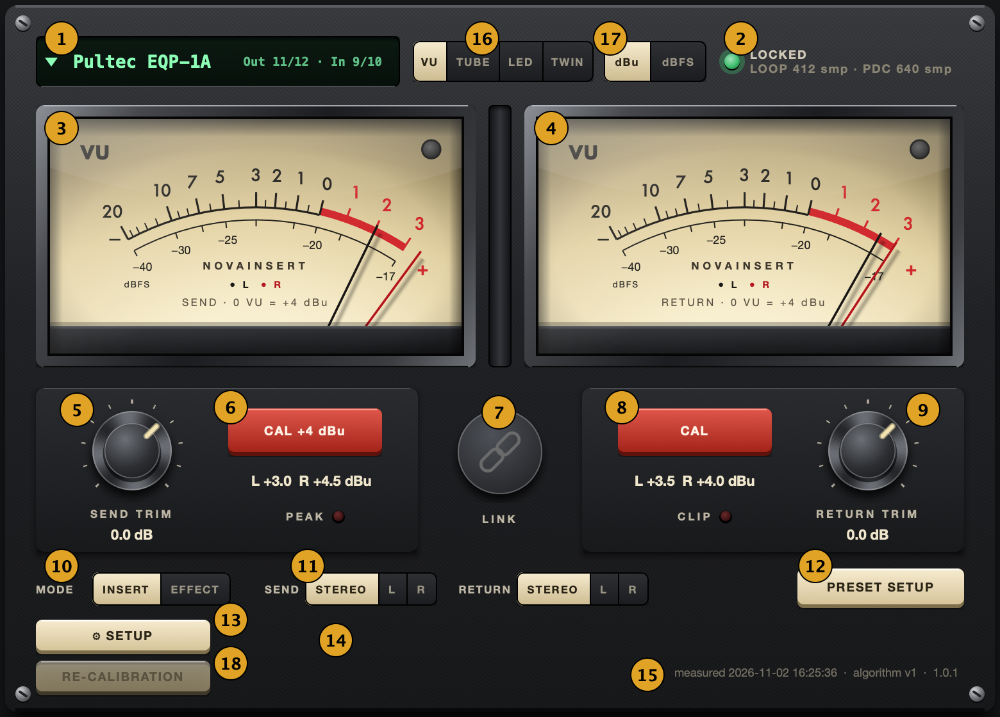

| № | Area | What it does |
|---|---|---|
| 1 | Device selector | the green display names the selected device and the physical channels it owns; click to pick another record or "No device" |
| 2 | Status lamp | the measurement state in colour and text, with the measured LOOP and the PDC reported to REAPER |
| 3 | SEND meter | VU of the signal leaving for the outboard; 0 VU = +4 dBu at the converter output |
| 4 | RETURN meter | VU of the signal coming back; 0 VU = the dBFS reference set in SETUP |
| 5 | SEND TRIM | gain before the converter, −24 to +12 dB; double-click resets to 0 |
| 6 | CAL +4 dBu | sets the send trim so the track itself leaves at 0 VU = +4 dBu |
| 7 | LINK | couples the two trims: more send, less return, same mix level |
| 8 | CAL (return) | measures the return and sets the return trim to digital unity |
| 9 | RETURN TRIM | gain after the converter input, −24 to +12 dB |
| 10 | MODE | INSERT (measured loop) or EFFECT (driver latency, tails preserved) |
| 11 | SEND and RETURN | shown for a stereo send / return only: STEREO uses both channels, L or R uses that one side of the unit |
| 12 | PRESET SETUP | the preset editor: create, edit, duplicate and delete devices (chapter 4) |
| 13 | SETUP | (row below, left) converter alignment, 0 VU reference, channel offsets, editor size |
| 14 | Status lines | calibration messages, the failure reason, warnings and tips |
| 15 | Footer | time of the last measurement, the algorithm version and the plug-in version |
| 16 | VU / TUBE / LED / TWIN | switches the meter area between the two VU faces and the three level-bar looks (chapter 8) |
| 17 | dBu / dBFS | the unit of both meters' readouts |
| 18 | RE-CALIBRATION | (under SETUP) measures the loop again; available only after a failed calibration (chapter 7) |

Each meter has a peak lamp in its upper right corner. The SEND strip has a PEAK lamp (the send reached −0.1 dBFS or more), the RETURN strip a CLIP lamp (a returned sample exceeded 0 dBFS). The readouts under the CAL buttons show the current level per channel: dBu for the send, dBFS for the return.

**Hover tips.** Rest the mouse pointer on any control for a moment and a short tip says what it does. This works on the main page, in SETUP and in PRESET SETUP.

### Resizing

Drag the lower right corner of the window to any size between 50 % and 300 % of the base size; the aspect ratio stays locked and everything is redrawn as vectors, so the editor is sharp at any size and on Retina displays. SETUP has buttons for the fixed steps 75, 100, 125 and 150 %. The size is remembered for the running REAPER session, not stored in the project.

## 6. Selecting a device

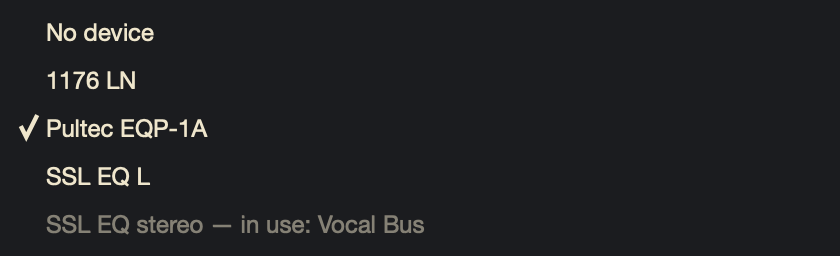

Click the green display. The list holds "No device" followed by every record in the library. A record whose channels another NovaInsert instance already owns is greyed out and shows "in use: <track>". Choose it anyway and the instance waits, muted, until the other one releases the channels.

Selecting a device does three things at once:

1. The FX slot in the mixer and the FX chain takes the device name. "No device" restores "NovaInsert". A manual rename of the slot is reverted.
2. The instance claims the physical channels. From now on this instance alone reads the inputs and writes the outputs.
3. In Insert mode the latency measurement starts, or a stored calibration for the same interface, channels, buffer size and routing is re-applied.

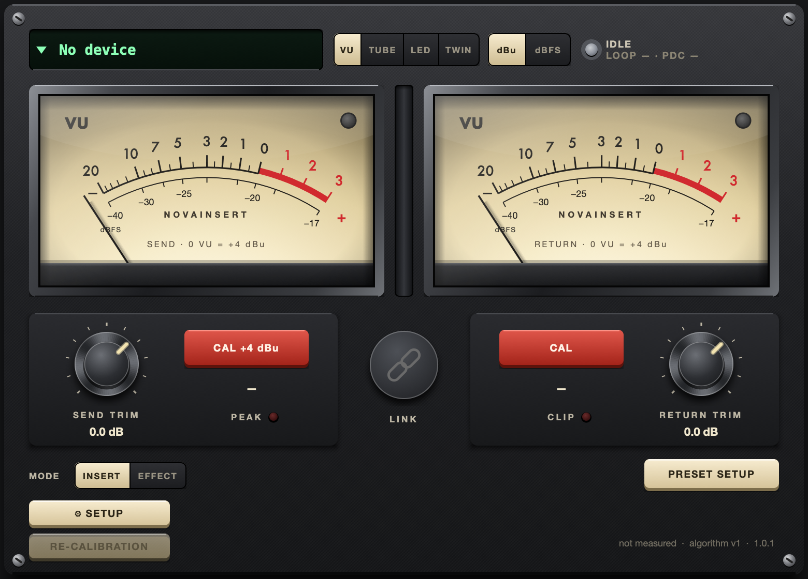

With no device the instance is idle: no route, no measurement, the audio passes through unchanged.

## 7. States and the status lamp

The lamp colour tells you whether the return is aligned:

| Colour | State | Meaning |
|---|---|---|
| grey | Idle | no device selected |
| blue | Queued | waiting for other instances to finish measuring (the position is shown) |
| blue | Measuring | the clicks are running (well under a second); the track output is muted meanwhile |
| blue | Applying latency | measured; waiting for REAPER to pick up the new delay on the next play |
| green | Locked | aligned; LOOP is the measured round trip, PDC the delay reported to REAPER |
| amber | Stale | something changed since the measurement; a re-measure is pending |
| red | Failed | the measurement did not lock; the reason is on the status line |
| red | Unavailable | the channels are owned by another instance, or the audio device is gone |
| red | Unsupported host | a REAPER setting NovaInsert needs is off (see anticipative FX) or the REAPER version lacks an API |
| red | Unsupported sample rate | the project is not at 48 kHz |

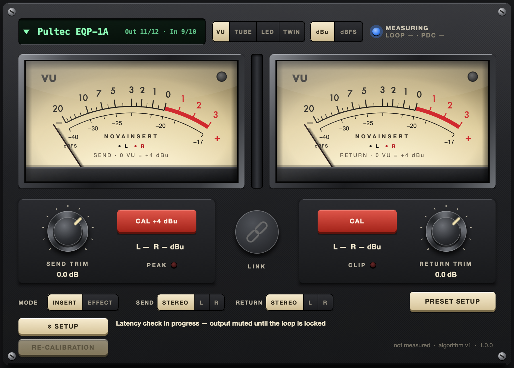

While measuring the host output of the track is silent with a short fade, the send carries only the clicks, and no click reaches playback. Each click is heard back in a few milliseconds, so a measurement usually finishes in about 0.3 s. The longest loop that can be measured is 0.45 s, far beyond any AD/DA plus outboard round trip. A measurement never starts while REAPER is recording; if recording starts during a measurement the attempt is cut and repeated afterwards.

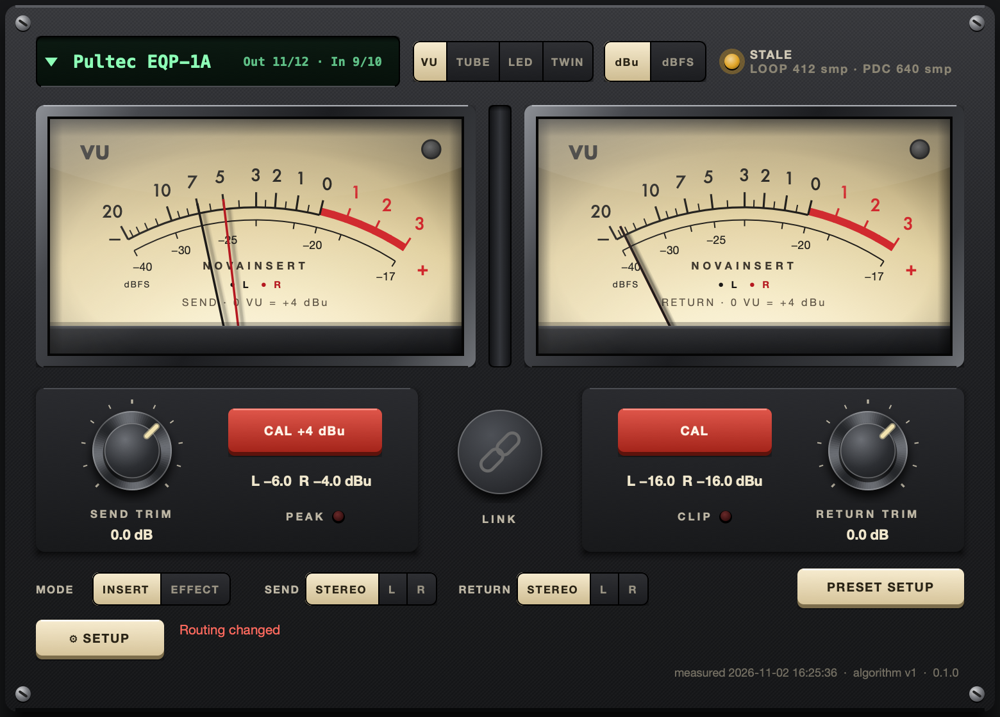

NovaInsert re-measures when the project loads (see "Opening a project" below), the audio device is reopened or changed, the buffer size changes, the routing or the mode changes, or a device conflict is resolved. The reason is written on the status line.


A failed measurement names its cause. The most common: no signal came back (cable or channel number), the return clipped, the loop had two candidate delays (an echo or crosstalk from a neighbouring unit), or the return was too weak. Fix the cause and press RE-CALIBRATION to measure again.

**Opening a project.** With "On project open: Measure the loop" ticked in SETUP (the default), every instance measures its loop when the project opens, one after another through the same queue as any other measurement, so a cable or patch change made while the project was closed is caught before you play. The latency saved with the project stays in reserve: if the measurement finally fails (after its retry) and the interface, channels, buffer size, routing and mode are still the ones the project was saved with, the instance runs on the saved latency instead of failing, and the status line says so:

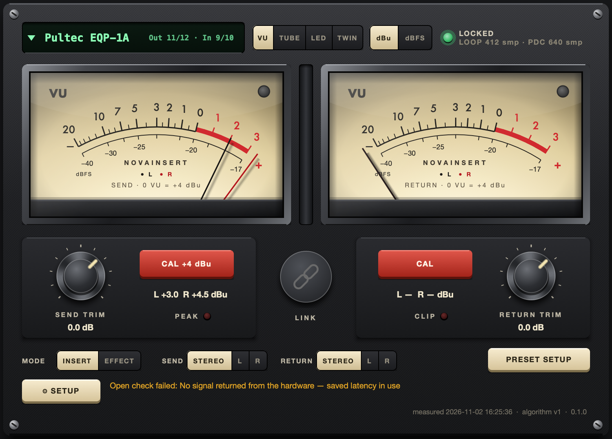

"Open check failed: <reason> — saved latency in use" means the return is aligned as it was when you saved, but this session could not confirm it. Fix the cause (the reason is the same as in the table in chapter 18) and press RE-CALIBRATION to measure again; a successful measurement clears the message. With the box unticked, a project reopens on its saved latency without any clicks, as long as nothing in that list changed; anything changed is always measured.

**RE-CALIBRATION.** The button under SETUP measures the loop again, through the same queue as any other measurement. It is available only when a calibration failed:

- the instance is Failed (red lamp, the reason on the status line), or
- the check on project open failed and the saved latency is running ("Open check failed … saved latency in use").

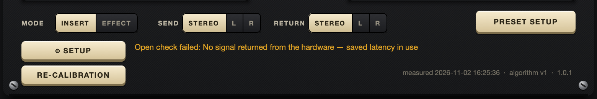

At any other time it is greyed out: a Locked instance with a good measurement needs no new one, and a measurement that is queued or running is not restarted. NovaInsert re-measures by itself for every change listed above. If the new measurement fails as well, the instance shows Failed with the new reason and the button stays available.

**Changing the buffer size.** REAPER only allows the device page while the transport is stopped: stop, change the buffer size, play. Every instance re-measures for the new block size and locks again.

## 8. Meters, trims and LINK

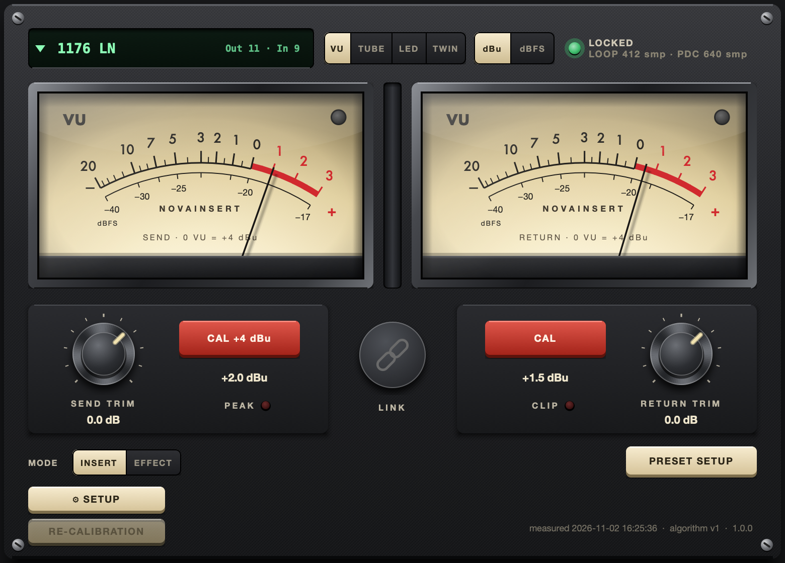

The two VU meters move like real ones: full-wave rectified average, 300 ms to 99 % of a step with 1.3 % overshoot, as IEC 60268-17 specifies. A mono device shows one black needle; a stereo device two, black for L and red for R, with a small legend on the face. Under the VU scale a dBFS sub-scale shows where the digital level sits.

- **SEND meter:** 0 VU corresponds to +4 dBu at the converter output. The dBFS sub-scale follows the converter alignment you set in SETUP (with 24 dBu at 0 dBFS, 0 VU is −20 dBFS). If the device record has an outboard maximum input level, a marker on the scale shows it.
- **RETURN meter:** 0 VU corresponds to the reference you choose in SETUP, −20 dBFS by default or −18 dBFS.

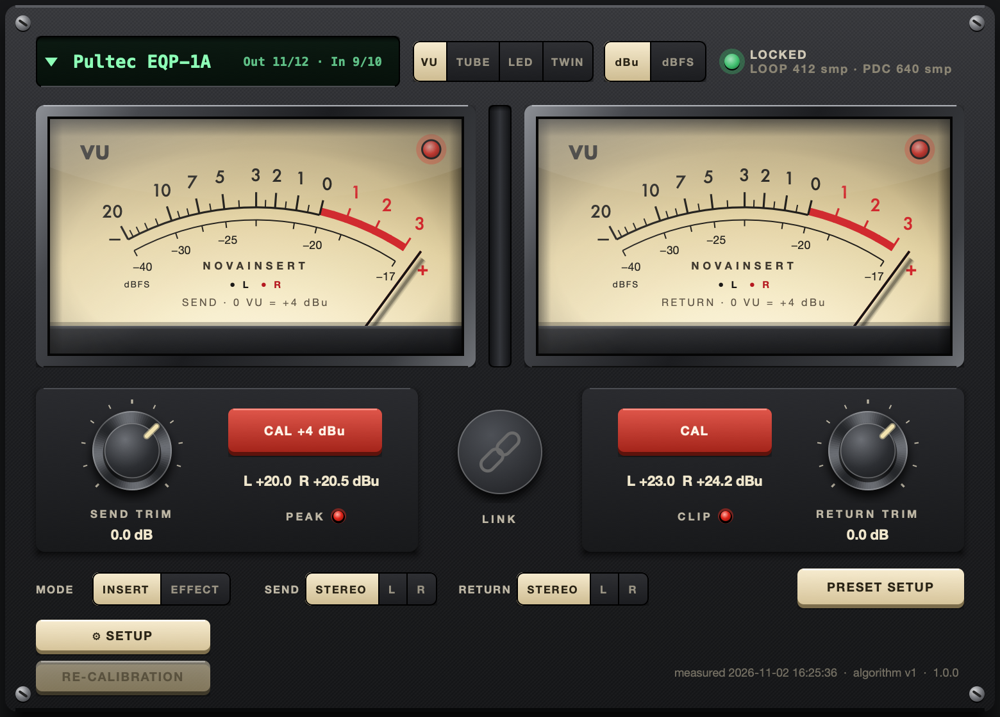

The lamp in each meter window and the PEAK lamp light when a sample reaches −0.1 dBFS or more (near full scale). The CLIP lamp lights only when a returned sample is above 0 dBFS, which means the converter input was overloaded. Analog overload inside the outboard is not detectable and is not claimed. Peak holds are kept for 10 seconds. Meters are display only; they never change the audio.

### The bar views: TUBE, LED and TWIN

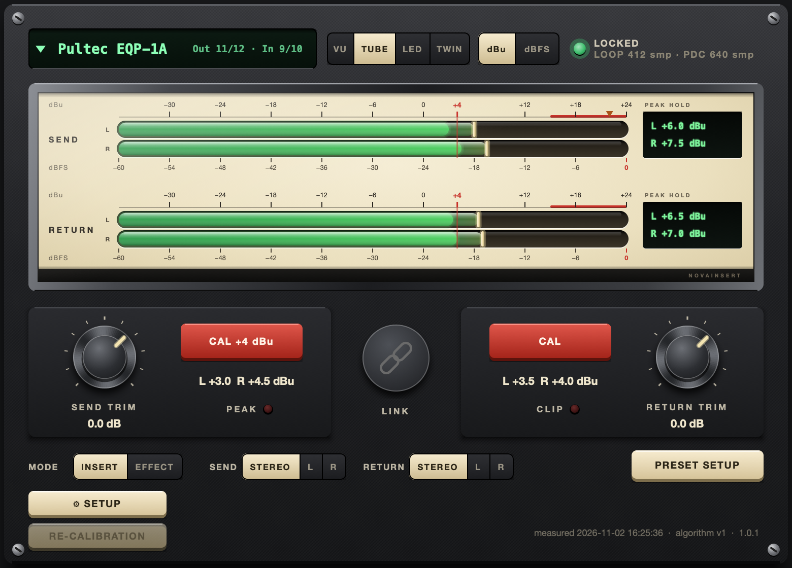

The rocker in the top bar has four positions: VU shows the two VU faces, TUBE, LED and TWIN show level bars in three different looks. The choice is remembered while REAPER runs and is shared by every NovaInsert window; it is not saved in the project.

- **TUBE.** One backlit cream face with SEND on top and RETURN below. Each channel is a glass tube that lights from green through yellow and orange to red.
- **LED.** The same layout on a dark smoked-glass face. Each channel is a row of 60 LEDs, one per dB.
- **TWIN.** Two windows the size of the VU faces, SEND on the left and RETURN on the right. Each has its own clip lamp, which lights while a held peak is at −0.1 dBFS or more, and the PEAK HOLD values are printed under the scale.

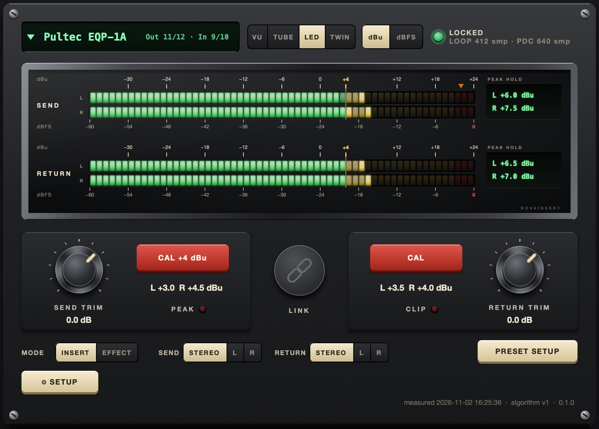

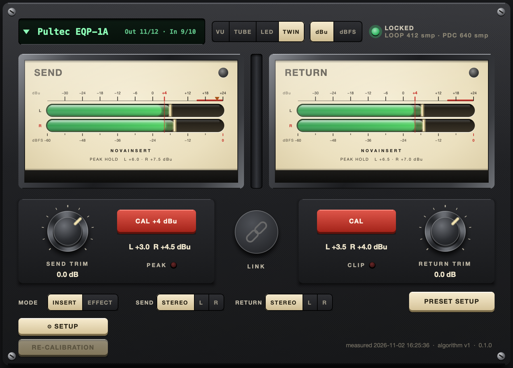

All three looks read the same way:

- **The bars.** The faint part of a bar (LED: the dimmer segments) is the peak level, which falls at 24 dB/s like REAPER's peak meters. The bright part is the RMS level. The bead (LED: one fully lit segment) is the peak hold (10 seconds). The scale runs from −60 to 0 dBFS. A mono device shows one bar per group, a stereo device shows L and R.
- **The dBu scale.** Each group reads on two scales: dBu above the bars and dBFS below. The SEND group's dBu scale follows the send alignment set in SETUP (with 24 dBu at 0 dBFS, +4 dBu sits at −20 dBFS), and the RETURN group's follows the return alignment. The +4 dBu tick is highlighted. The line through the bars is the group's 0 VU reference: +4 dBu with dBu selected, the SETUP reference with dBFS selected. If the preset has an outboard maximum input level, a small triangle above the SEND bars marks it.
- **PEAK HOLD.** The held peak per channel, in the unit chosen with the dBu | dBFS rocker. In TUBE and LED it turns red when it reaches −0.1 dBFS.

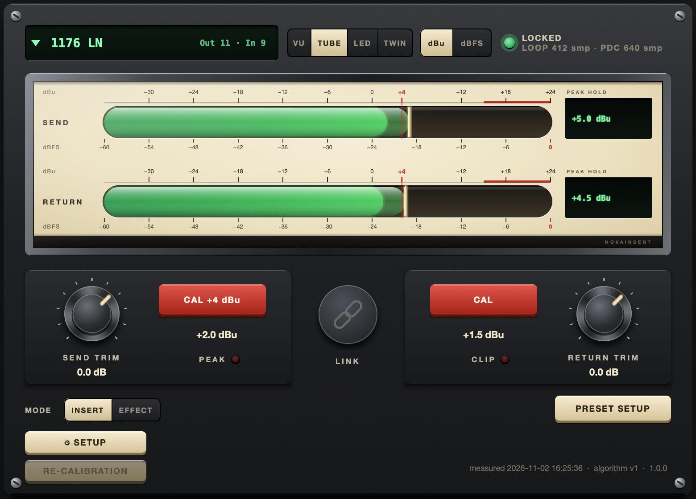

**Trims.** SEND TRIM sits before the converter output, RETURN TRIM after the converter input, each from −24 to +12 dB in 0.1 dB steps. Drag the knob, use the mouse wheel, or double-click to return to 0 dB. Both are REAPER parameters and can be automated.

**LINK.** With LINK on (amber) the trims move against each other: raise the send by 3 dB and the return drops by 3 dB, so you can drive the outboard harder without changing the level of the mix. With LINK off they are independent.

## 9. Level calibration

Most outboard expects line level around +4 dBu. A converter aligned to +24 dBu at 0 dBFS sends a full-scale DAW signal 20 dB above that, which overloads the unit's input, and the unit's output can in turn overload the converter on the way back. The calibration solves this per device, once.

**Step 1: set the converter alignment in SETUP.** Open SETUP and choose the interface preset: "Apollo x / +4 · 24.0", "Apollo Twin MkII · 20.2", or Custom with the dBu-at-0-dBFS values from your interface's manual, separately for the send (D/A) and the return (A/D). Choose the 0 VU reference you work with. If the unit has a known maximum input level, enable "Limit" and enter it: the SEND meter then shows a marker you should stay under.

**Step 2: put the outboard in a neutral state.** Bypass or flatten the unit: unity gain, EQ flat, compression off. The calibration assumes the signal comes back at the level it went out.

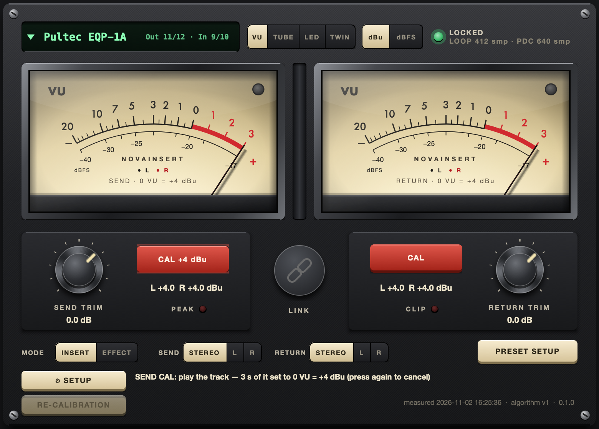

**Step 3: SEND CAL.** Play the track and press "CAL +4 dBu". NovaInsert listens to the track's own material as it leaves the converter (nothing is muted, no tone is played), averages 3 seconds of it, and sets SEND TRIM so that this average sits at 0 VU = +4 dBu at the converter output. With a +24 dBu alignment that is −20 dBFS; with a +20 dBu Apollo headroom setting it is −16 dBFS. Silence does not count: press CAL before playback and it waits for the music (up to 30 seconds). Moving the trim while it listens does not spoil the result. Press the button again to cancel. With LINK on, the return trim moves by the opposite amount, so the level of the mix stays the same while the outboard is driven at +4 dBu. SEND CAL belongs to the track: it does not change the device's stored defaults. It also works in Effect mode.

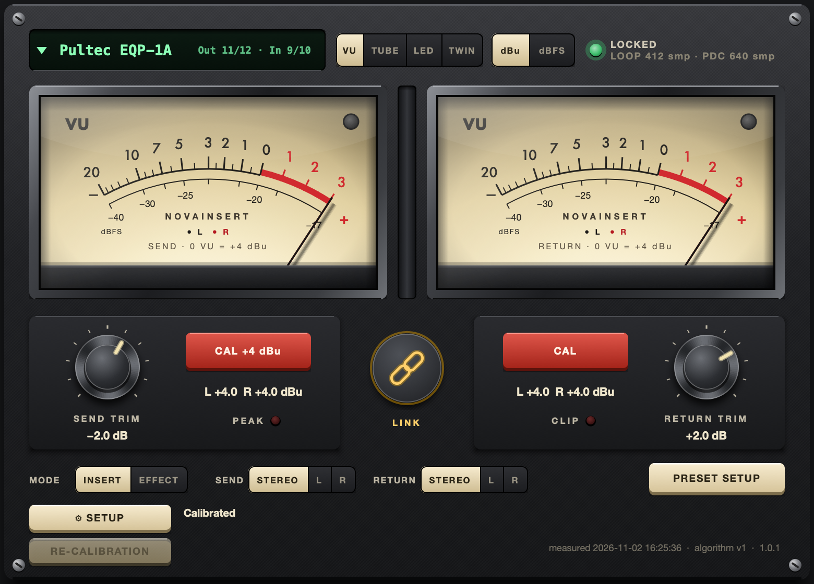

**Step 4: RETURN CAL.** Press "CAL" on the return side. The tone goes out through the send trim and the neutral outboard; NovaInsert measures what comes back and sets the return trim so that the plug-in's output equals its input: with the unit in the chain the mix is neither louder nor quieter. A mismatch between the send and the return converter is corrected automatically. Stereo units are calibrated per channel, so two channels that differ by a fraction of a dB are each brought to unity.

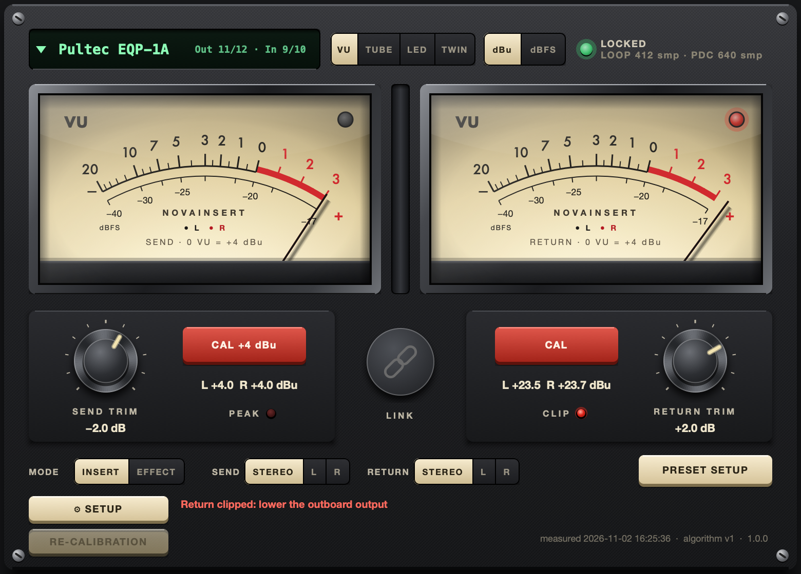

If the return clips at the converter the calibration writes nothing and asks you to lower the outboard's output; a trim after the converter cannot undo an overloaded input.

**What is stored.** A RETURN CAL result is written to the running instance and as the default of the device record, so every new use of that device starts from it. When a project's stored values differ from the library defaults, the status line says "Device defaults changed — see SETUP" and SETUP offers "APPLY DEVICE DEFAULTS"; nothing is applied on its own.

CAL is refused, with a message, while recording, without an owned device, and while a latency measurement is running (a measurement that starts during SEND CAL cancels it). RETURN CAL also needs Insert mode. SEND CAL reports "no track signal within 30 s" when nothing played, and "too quiet or too loud for the trim range" when the needed trim lies outside −24…+12 dB; neither writes anything.

## 10. SETUP

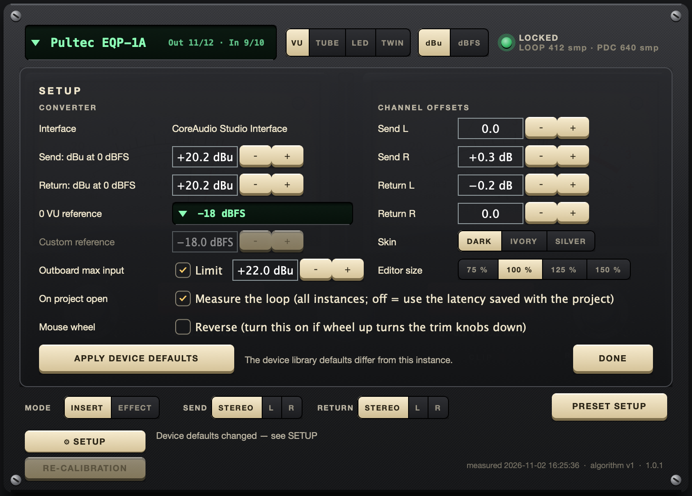

| Field | Meaning |
|---|---|
| Interface preset | Apollo x / +4 (24.0 dBu), Apollo Twin MkII (20.2 dBu) or Custom |
| Send: dBu at 0 dBFS | the analog level at full scale on the output the device uses |
| Return: dBu at 0 dBFS | the same for the input |
| 0 VU reference | −20 dBFS, −18 dBFS or a custom value from −30 to −6 dBFS; the RETURN meter and the CAL maths follow it |
| Outboard max input | optional marker on the SEND scale |
| Channel offsets | per-channel fine trims in 0.1 dB steps for L and R on the send and the return, on top of the main trims; the R rows are enabled for a stereo send / return |
| Skin | DARK (default), IVORY or SILVER: the colour scheme of the whole editor (below). One setting for all instances, stored in `settings.json`; every open editor follows within a second |
| Editor size | 75, 100, 125 or 150 % |
| On project open | ticked (default): every instance measures its loop when a project opens and falls back to the latency saved with the project if that fails; unticked: a project reopens on its saved latency without measuring (chapter 7). One setting for all instances, stored in `settings.json` |
| APPLY DEVICE DEFAULTS | takes the library record's trims, LINK and offsets into this instance; shown when they differ |

Changes are applied immediately and stored in the device record (On project open, Skin and Editor size are global, not per device). DONE closes the page.

### Skins

Besides the dark housing there are two light skins. They change colours only; every control sits where it does in DARK and works the same.

- **IVORY**: a warm ivory panel with dark knobs, dark buttons and the green device display; the meters keep their cream faces.

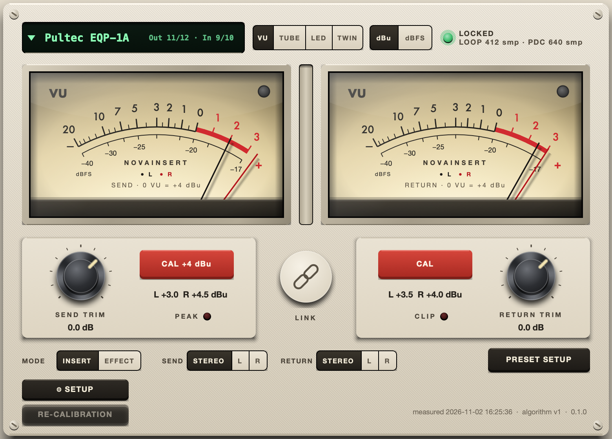

- **SILVER**: brushed silver with machined knobs, black buttons, orange CAL buttons, an amber device display and amber backlit meter faces. The LED view and the PEAK HOLD read-outs stay dark glass in every skin.

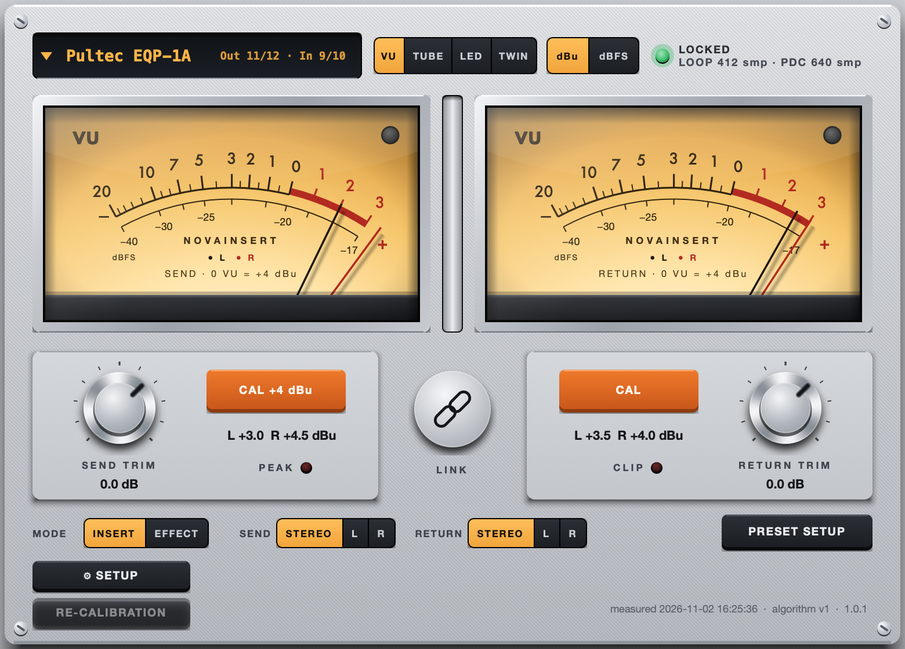

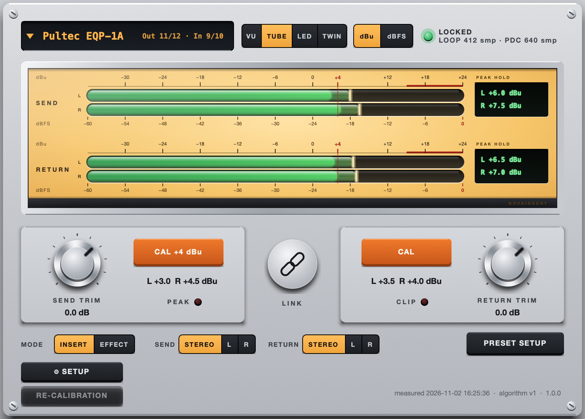

## 11. Insert and Effect mode

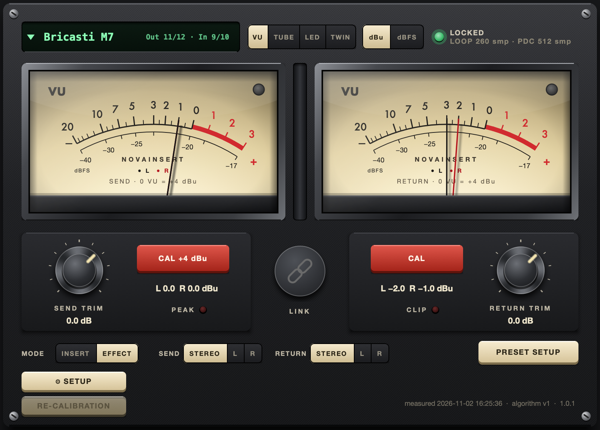

**INSERT** is for gear that should be sample-aligned: equalisers, compressors, summing, tape, anything where the return is the processed version of the send. The loop is measured and the return is placed exactly.

**EFFECT** is for gear whose output is not a time-aligned copy of its input: reverbs, delays, anything with a tail. Nothing is ever measured; a click through a reverb would be meaningless and the tail must survive input silence. NovaInsert reports the audio driver's own round trip plus the two-block margin as the delay, re-reads it on every buffer change, and leaves the return alone. The lamp shows LOCKED as soon as the driver value is applied. Alignment in Effect mode is as exact as the driver's figure, not sample-measured.

Switching the mode re-evaluates the latency source; in Insert mode that means a measurement.

## 12. Mono and stereo routing

The preset says whether the send and the return are mono or stereo; the two are independent.

- **Stereo send** — the track's L channel goes to the first output, R to the second. No summing, no swapping.
- **Mono send** — the average of the track's two channels, (L + R) / 2, goes to the one output. A mono track (the same signal on both channels) therefore leaves at exactly its own level, and nothing has to be sent twice.
- **Stereo return** — the first input returns to L, the second to R.
- **Mono return** — the one input returns to both channels of the track. No channel is left silent.

For a stereo send or return the main panel shows a SEND or RETURN selector: STEREO uses both channels of the unit; L or R uses only that side as a mono loop, with the same (L + R) / 2 send and the same return to both sides as a mono preset. The unused output of the unit is never written. Mixed choices such as a one-sided send with a stereo return are allowed, but in Insert mode the loop can only lock when the unit really returns the signal on both inputs.

The selectors are part of the calibration key, so changing them re-measures.

## 13. Rendering

Hardware cannot run faster than real time, so a render through NovaInsert must be a realtime render. You do not have to remember this:

- Starting a render (master mix, stems, selected tracks, regions, the region matrix, a dry run) sets REAPER's render speed to realtime and restores your previous setting when the render ends or the dialog closes. If you changed the setting during the render, it is left alone and the editor says "Render speed left at <value>".
- Before the render starts every active instance is checked. If one is not Locked, the render is refused and a message names the tracks. No file is written. Lock them, or bypass the instances you do not need, and render again.
- Freeze (stereo, mono, multichannel) and render tracks to stem tracks (stereo, mono, multichannel) are realtime renders too: NovaInsert switches REAPER's "Limit apply FX/render stems to realtime" preference on for the action and puts your own setting back afterwards, and the same Locked check runs first.
- **Apply FX to items is refused** while a NovaInsert instance is active. REAPER stops the audio interface during Apply FX, even at realtime speed, so the outboard gear cannot be part of the result and every instance would lose its calibration. A message says so; use Freeze or Render tracks to stem tracks instead.
- The render queue cannot go through hardware (it renders a saved copy of the project) and is refused while an instance is active.

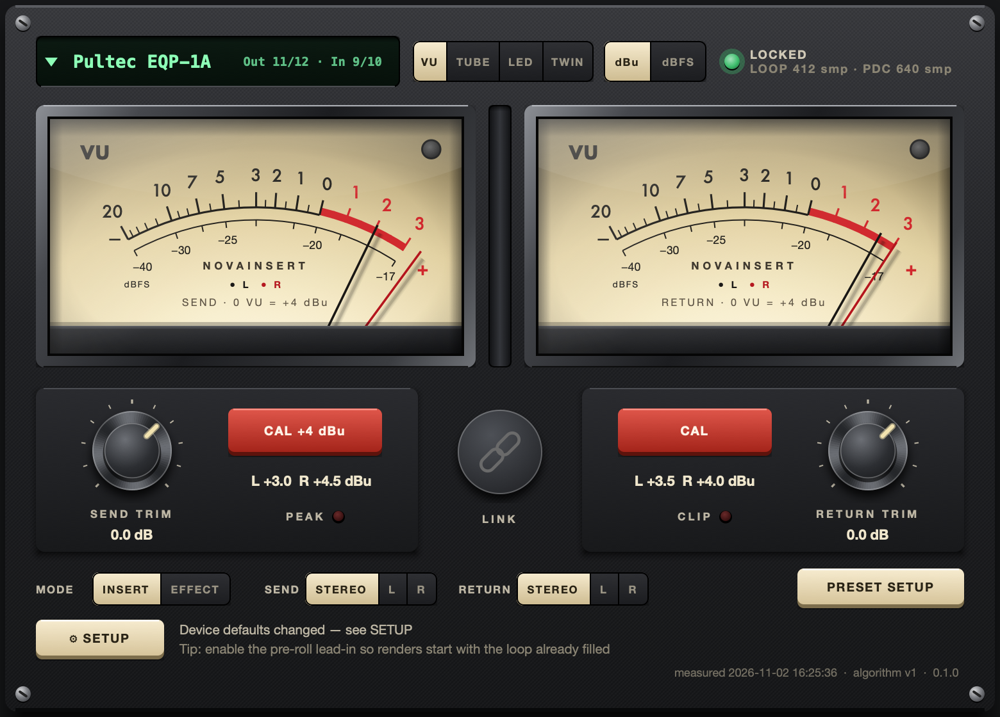

**The inherent start gap.** REAPER fills the compensation delay from the start of each play or render pass, so the first "loop length" samples of a pass have no hardware return yet. NovaInsert reports the gap instead of hiding it. The cure is to start earlier: enable REAPER's pre-roll, and set the "Pre-roll lead-in" parameter of the instance to tell NovaInsert you have; the tip then disappears.

## 14. Several devices in one project

- Each physical channel has one owner. A second instance that selects a record sharing an output or an input with a running instance shows "Unavailable" and "Device in use by <track>", stays muted and does not measure. When the owner changes device or is removed, the waiting instance measures and takes over.
- Measurements of different units run in parallel. If a click is disturbed by a neighbour's click, the attempt is rejected and repeated alone.
- Loading a project with many instances queues them; the lamp shows "Queued" with the position.
- The same record twice on different, free channels is allowed with a warning.
- REAPER's own hardware sends on an output NovaInsert uses are reported as a warning.

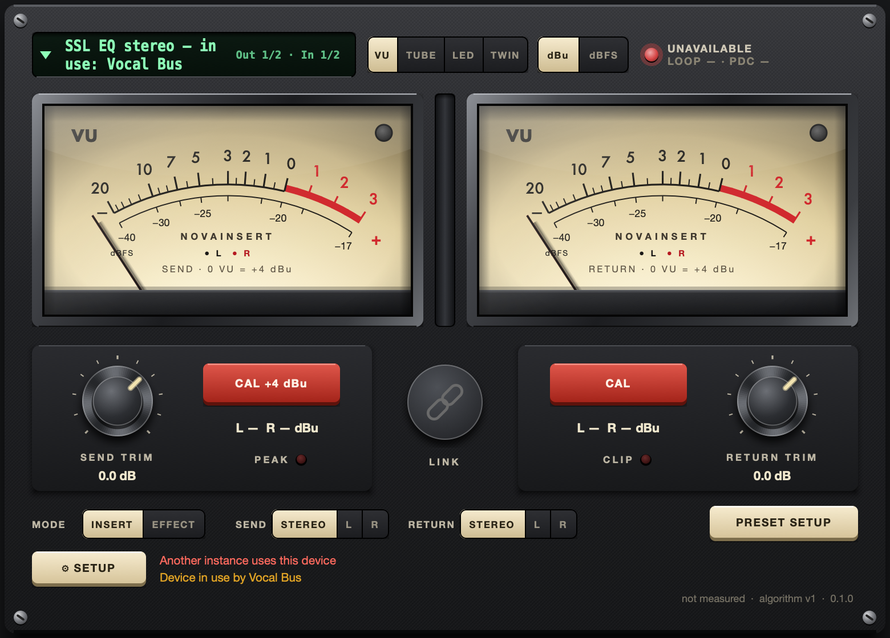

## 15. Anticipative FX

REAPER's "anticipative FX processing" runs plug-ins ahead of time, which breaks a live hardware loop. NovaInsert turns it off for every track that holds an instance and every folder above it, and restores the setting when the last instance leaves, provided you did not change it in between. The global preference is never touched.

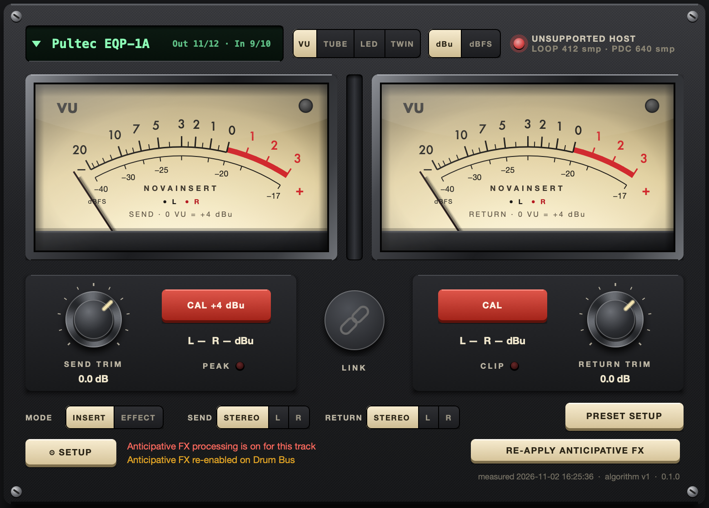

If you turn anticipative processing back on for such a track, the instance leaves Locked and shows "Unsupported host" with the reason. Press "RE-APPLY ANTICIPATIVE FX" on the right of the status area to switch it off again.

## 16. Parameters

These appear in REAPER's parameter list, for automation, modulation and parameter linking.

| Parameter | Values | Notes |
|---|---|---|
| Device | 0 = none, 1… = library index | the same as the device selector |
| Mode | Insert, Effect | |
| Send | Stereo, L, R | the side of a stereo send; a mono send ignores it |
| Return | Stereo, L, R | the side of a stereo return; a mono return ignores it |
| Stereo | off/on | follows the record |
| Send trim, Return trim | −24 … +12 dB | |
| Link | off/on | |
| Pre-roll lead-in | off/on | hides the start-gap tip; set it when you render with pre-roll |
| Re-apply anticipative FX fix | trigger | the same as the button |
| State, Physical loop, Reported PDC, Inherent gap, CAL action, CAL status | read only | for scripts and controllers |

## 17. Files and projects

| File | Content |
|---|---|
| `…/REAPER/NovaInsert/devices.json` | the device presets, chapter 4 |
| `…/REAPER/NovaInsert/calibrations.json` | measured loops, one per interface, channels, buffer size, routing and mode; written after every lock |
| `…/REAPER/NovaInsert/settings.json` | global settings; SETUP writes "measureOnOpen" and "skin" (0 Dark, 1 Ivory, 2 Silver) here |
| the REAPER project | the instance's full configuration plus a snapshot of its device record and calibration |

The snapshot means a later edit of the library cannot change how an old project sounds. When a project's snapshot differs from the library, the editor says so ("The library record differs from this project's snapshot (kept)") and keeps the project's values. Back up the two JSON files with your templates; nothing else is written anywhere.

## 18. Messages and what to do

| Message | Meaning | What to do |
|---|---|---|
| No signal returned from the hardware | no click came back within 0.45 s | check the input channel number, the cable and the unit's output; a loop longer than 0.45 s also ends here |
| The return clipped during the probe | the converter input overloaded | lower the outboard output or raise its input threshold |
| Ambiguous correlation peak (echo or crosstalk) | two candidate delays | look for a double path (patchbay normals, a parallel send) or a neighbouring unit's click |
| Return too weak against the noise floor | the loop gain is very low | raise the unit's output, check pads |
| Loop latency outside the supported range | more than 65 536 samples or negative | shorten the chain; a networked or lookahead device may exceed the range |
| Repeated probes disagreed | the three clicks came back at different delays | an unstable clock or a device changing its latency; check the clock source |
| Left and right loops differ | a stereo record measured two different delays | the two channels take different paths; use two mono records |
| REAPER did not apply the new latency in time | PDC was not picked up | press play once; if it stays, reopen the audio device |
| Only 48 kHz is supported | the project runs at another rate | set the project and the device to 48 kHz |
| Select a specific audio device, not <default> | REAPER uses the system default device | pick the interface by name in REAPER's audio device settings |
| Another instance uses this device | channel conflict | wait, or change one of the records |
| Measurement paused while recording | a measurement was due during recording | it resumes when recording stops |
| Anticipative FX processing is on for this track | you re-enabled it | press RE-APPLY ANTICIPATIVE FX |
| Audio device lost | REAPER lost the interface | reconnect; the instance re-measures when it returns |
| Open check failed: <reason> — saved latency in use | the measurement on project open did not lock; the latency saved with the project is running | fix the cause named after the colon, then press RE-CALIBRATION |
| Unvalidated host version <v> | REAPER is not one of the validated versions (7.83, 7.85) | informational; everything runs |
| Device library: … | the JSON file is missing, unreadable, read-only or newer than this version | fix the file; nothing was overwritten |
| SEND CAL: play the track — 3 s of it set to 0 VU = +4 dBu | SEND CAL is listening to the track | chapter 9 |
| Return clipped: lower the outboard output | RETURN CAL refused | chapter 9 |
| Loop gain outside the trim range | the return differs from the send by more than the trims can correct | check the unit's gain structure |
| CAL needs Insert mode / is not available while recording / Select a free device first / Wait for the latency measurement | CAL preconditions | see chapter 9 |

## 19. Limitations of version 1.0.0

- 48 kHz, REAPER 7.83 or newer (validated on 7.83 and 7.85), macOS Apple silicon, VST3 only.
- Presets are stored by position: deleting one shifts the later ones in projects that have not been reopened since (chapter 4).
- The first "loop length" samples of each play or render pass have no hardware return (chapter 13).
- Effect mode alignment is driver-reported, not sample-measured.
- Apply FX to items and the render queue are refused while an instance is active (freeze and stem tracks render in realtime).
- A change of the outboard's own settings after the calibration is not detected; the footer shows when the loop was measured.
- Analog overload inside the outboard is not detectable.

## 20. License

NovaInsert is free to use, including in professional and commercial audio work. It is provided as is, without any warranty, and the author accepts no liability for damage to equipment, hearing or data. Commercial reuse of the source code or the GUI design requires prior consultation with the author. The full agreement is shown by the installer and shipped as LICENSE.md.

Built with JUCE 8 and the VST3 SDK. VST is a trademark of Steinberg Media Technologies GmbH. REAPER is a trademark of Cockos Incorporated.

## 21. About Hillside Studios

NovaInsert is made by Hillside Studios. If you are interested in the studio and its work, visit [hillsidestudio.io](https://hillsidestudio.io).
